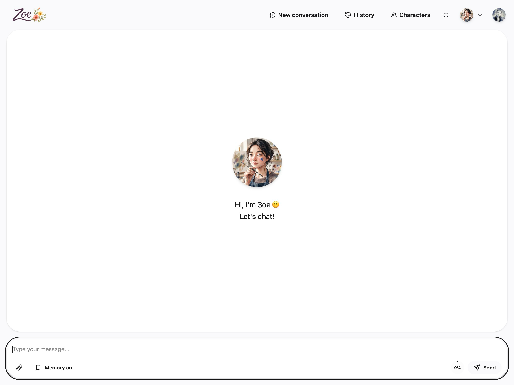
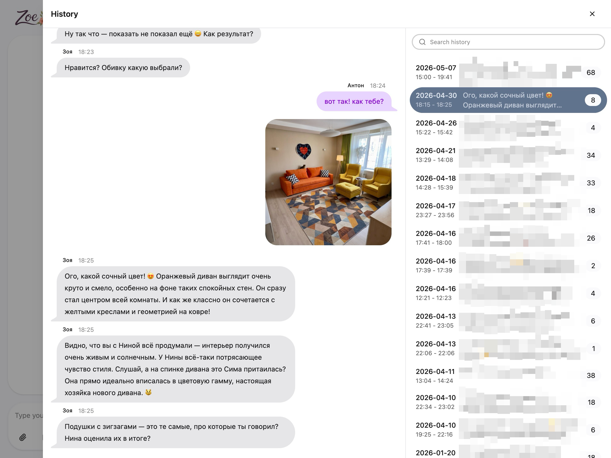
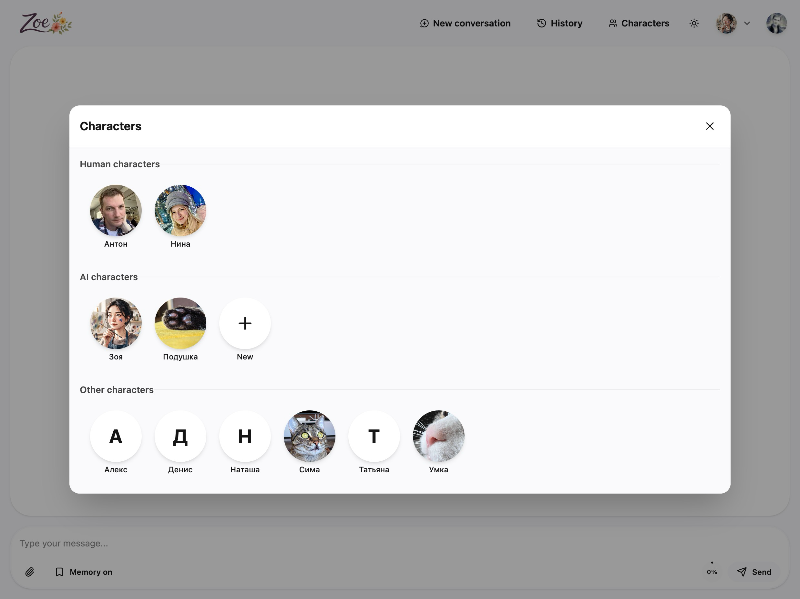
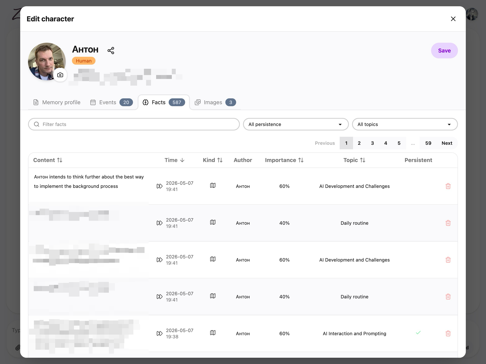
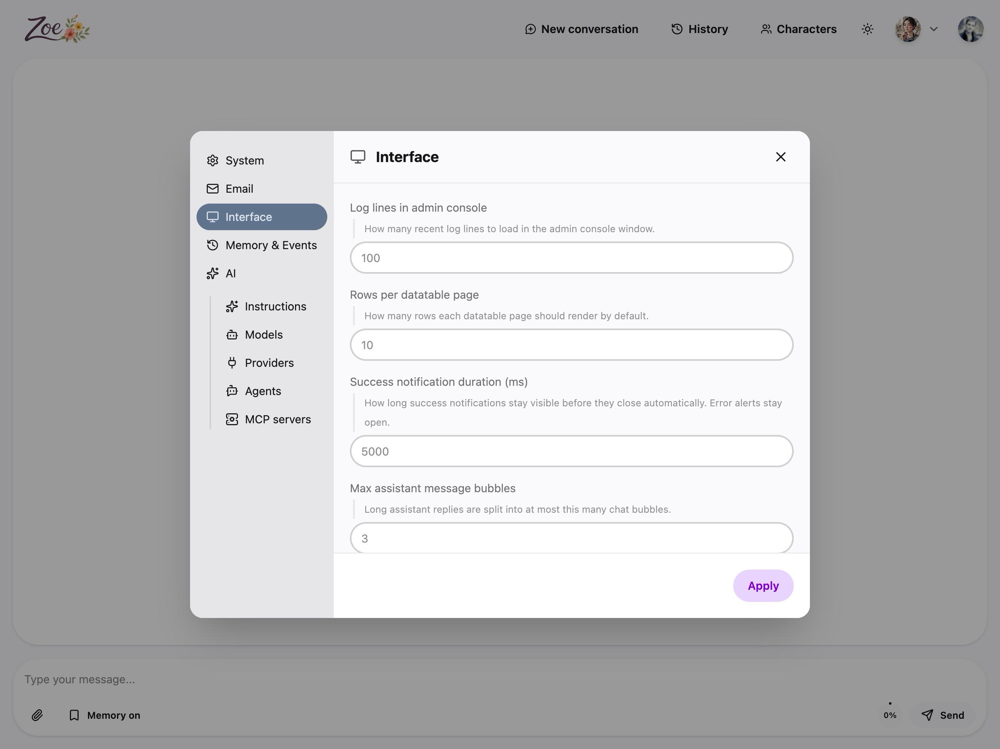

# Zoe AI

Zoe AI is a Rails-based multi-character AI companion platform built around persistent memory, not disposable chat sessions.

Most chatbots are optimized to answer the current prompt well. Zoe is optimized to build a durable understanding of people over time: who they are, what they care about, what changed recently, and which details should still matter months later.

It is also not limited to a single user talking to a single bot. Many users can register, create multiple characters, talk to different AI or human-like personas, and share characters between accounts so those characters accumulate a common memory across relationships and conversations.

## What makes Zoe different

- **Persistent memory is the product, not a bolt-on.** Zoe extracts structured facts from conversations and stores them as first-class application data.
- **It is multi-user and multi-character by design.** Users are not locked into one assistant identity. They can create and manage multiple characters with distinct roles, instructions, and histories.
- **Characters can be shared.** The same character can belong to multiple users, which makes shared memory a product feature instead of a workaround.
- **It separates long-term identity from short-term events.** A stable preference and a one-off plan are not treated the same, which makes memory more useful and less noisy.
- **Memory is organized by person and topic.** Facts are attached to characters and grouped into topic-based aggregates, so recall can stay specific instead of collapsing into a single summary blob.
- **Memory evolves over time.** Zoe maintains monthly and rolling summaries of persistent facts, which lets it keep a compressed but durable picture of someone as conversations accumulate.
- **AI characters can “dream” between chats.** Hidden internal dream sessions let an AI character reflect on yesterday’s conversations, refine follow-up ideas, update dream-only instructions, and prepare better continuity for the next real dialog.
- **It works with images as part of the relationship.** Zoe can understand uploaded images, use them to enrich character profiles, and generate new pictures with visual references from prior chats and saved character photos.
- **It supports two-way voice interaction.** Zoe can speak replies aloud and accept spoken input, including continuous listening that turns short speech pauses into sent messages.
- **It keeps temporal context grounded.** Zoe presents memories, follow-ups, and ongoing situations with a sense of recency and continuity, so conversations feel connected to real time instead of floating in a timeless chat loop.
- **Conversations stay conversational.** Fact extraction and summarization run asynchronously in background jobs, so the chat flow remains responsive while memory is updated behind the scenes.
- **It is built as a conventional Rails app.** The core is ActiveRecord models, Hotwire and Stimulus for the interactive UI, background jobs, prompt templates, and service actors rather than a black-box chatbot stack.

In practice, Zoe behaves less like a stateless assistant and more like an AI relationship layer: create characters, chat, remember, interpret shared context across text and images, refine, share, and reuse that memory in later conversations.

## Screenshots

### Main chat



### Chat history



### Characters list



### Character profile



### Settings



## How it works

1. A user sends a message in a chat.
2. Zoe replies using the configured LLM provider and model.
3. The conversation is replayed through a fact extraction agent.
4. Extracted facts are stored with subject, author, topic, time, importance, and persistence metadata.
5. Persistent facts are re-aggregated into monthly and rolling summaries.
6. Future chats can use those summaries as long-term memory context.
7. The assistant can stay grounded in both visual context and conversational recency, which makes follow-ups and generated media feel consistent with the relationship so far.

## Dreaming sessions

Zoe supports internal “dreaming” sessions for AI characters with dreaming enabled.

### What a dream session is

- A dream session is an internal reflection phase that runs separately from the normal user-facing conversation.
- Dreaming happens per relationship, so the same AI character can reflect differently on different people.
- These sessions are hidden from normal chat history and exist to improve continuity rather than to create another visible conversation thread.

### When dreams run

- Dreaming runs on a schedule after normal chats have been closed for the day.
- In general, dreams are triggered by recent real conversations, and they can also be configured to run daily even when there was no new chat.

### What the dreaming agent sees

- The same core relationship context as a normal chat: who the people are, what is already known about them, and what has been happening recently.
- The recent real conversations for that relationship, typically grouped by the previous day rather than a single latest message.
- Separate dream-specific instructions in addition to normal conversation instructions.
- Prior internal dream traces and time-bound events, so the AI can notice patterns across memory, recent chats, and unfinished threads.

When there was no recent real chat, dreaming falls back to broader memory and event context instead of inventing momentum.

### What the dreaming agent can do

- Re-read relationship context and look for non-obvious but grounded connections.
- Search past conversation context when the immediate dream input is not enough.
- Prepare or refine possible next-chat follow-ups.
- Update its own dream-specific reflection rules when repeated patterns suggest a better strategy.
- Generate supporting creative artifacts, such as images, when that meaningfully helps a future follow-up.

### How dream output is used

- Dream sessions can leave internal notes, queue future follow-up ideas, and refine private continuity for the next real conversation.
- Their output is meant to shape future chat quality, not to surface itself directly to the user.
- Information produced during dreaming can still become part of the AI’s internal memory when it is treated as useful and grounded.

### Settings

- Dreaming can be enabled or disabled per AI character.
- Dreaming behavior can be configured separately from normal conversation behavior.
- Both global dream instructions and per-character dream instructions can be used to shape how reflection works.

## AI tools and MCP

Zoe is not limited to pure text generation. AI characters can use tools when a response or an internal reflection session calls for something more than recalling context from the prompt alone.

### Available built-in tools

- **`event_search`**: search recent happenings, plans, and other time-bound remembered context.
- **`chat_history_search`**: re-open prior closed conversations when deeper context is needed.
- **`delegate_task`**: give a specialist a task and return its answer to the current conversation.
- **`agent_history`**: find previous specialist conversations and read their tasks and answers.
- **`draw`**: generate new images that fit the current relationship, mood, or follow-up idea.
- **`manage_postponed_messages`**: prepare future follow-ups or next-chat messages.
- **`manage_own_instructions`**: update character-specific behavior rules over time, including dream-specific reflection rules.
- **`set_character_avatar`**: set a character’s avatar from an image shared in chat.
- **`add_character_image`**: add a reference image or photo to a character profile.

These tools are used selectively. The model can stay purely conversational when memory and prompt context are enough, or switch into tool use when it needs retrieval, planning, or media creation.

### MCP support

Zoe also supports MCP (Model Context Protocol) servers.

- MCP lets the app expose additional external tools to AI characters without hard-coding every capability into the core application.
- This makes the tool layer extensible: search, retrieval, workflow, or other custom capabilities can be plugged into the system as MCP servers.
- From the AI’s point of view, MCP tools become part of the same general tool-using workflow as the built-in capabilities.

In practice, this means Zoe can combine persistent memory, normal prompt context, built-in tools, and MCP-provided tools into one conversational system.

### Delegate a task

Run `bin/rails db:migrate db:seed` to create the **Workspace Assistant** profile and its **Workspace Runner** connector. Under **Settings → Agents**, give each specialist a description of the work it can do. Zoe sees the names, selectors, and descriptions of active custom agents available to the current user and chooses one based on the request and earlier messages. Internal instructions configure the specialist itself. You can also name the agent you want. Each run shows its progress in the conversation. Expand it to see tool activity and completion or failure.

Each specialist conversation has a permanent `conversation_id`. Every task in it creates an `AgentRun` with its own progress, result, and link to the initiating message. Open the agent dialog from its run’s progress card in the current chat or in chat history. The drawer shows the agent’s tasks and answers in order. PostgreSQL keeps the specialist’s messages and tool activity with each run. Fact extraction reads the ordinary Zoe chat.

For example, after delegating a project listing, ask “Go back to the agent that listed my projects and ask it which names it saw.” Zoe can find that conversation using `agent_history` even in a later chat with the same user and characters, then pass its ID to `delegate_task`. Local workspace conversations also resume on the same workstation. Each run saved before the introduction of conversations starts its own conversation.

The stored transcript can outgrow the model’s context. Server-side specialists replay up to 30 recent turns within the model budget, including tool calls and results when they fit. The local runner replays up to eight completed turns. Earlier tasks and answers remain available through the conversation history.

### Connect a workstation

**Workspace Runner** is a separate Ruby service in the `zoe-workspace-runner` repository. It runs ActiveHarness on the computer that owns the files. Its README covers installation and the workspace directory, DeepSeek key and runner token. Start it there with `bin/server`. The default address is `http://127.0.0.1:7331/mcp`.

1. Set `WORKSPACE_RUNNER_ROOT` to the directory containing the projects you want to share. The runner needs write access for file changes. Configure the runner's Docker image on the workstation to enable its isolated project terminal. Keep the service reachable from the Zoe worker. Loopback works when both processes share a host and network namespace. For a remote deployment, use the workstation’s private network hostname or an authenticated tunnel. If using a reverse proxy, add its hostname to `WORKSPACE_RUNNER_ALLOWED_HOSTS` on the workstation.
2. Open **Settings → MCP servers → Workspace Runner**. Choose `streamable_http`, enter the reachable URL in the JSON configuration and enable the connector. You can also open the connector editor beside its name in **Settings → Agents**. Set `WORKSPACE_RUNNER_TOKEN` in the environment of Zoe’s web and worker processes to match the runner token, or put the bearer header in the connector JSON.

   ```json
   {
     "url": "https://workstation.example.internal/mcp",
     "headers": { "Authorization": "Bearer YOUR_RUNNER_TOKEN" }
   }
   ```

3. As a Zoe administrator, ask “Read the README in zoe-ai and tell me how to start the project.” Zoe calls `delegate_task` with the selected agent and the task. Attaching the Workspace Runner connector to a custom agent routes new conversations for that profile to the workstation and makes the profile available to administrators. Profiles without this connector use their configured model and tools. The runner reports tool activity as it works and returns its answer directly to Zoe. The workstation must be awake and connected. The browser can be on another device.

To share a project already on the workstation, put a directory symlink directly in the workspace root. For example, if the workspace is `~/ZoeWorkspace`, run `ln -s ~/Projects/zoe-ai ~/ZoeWorkspace/zoe-ai` and restart the runner. Then ask Zoe to read `zoe-ai/README.md`. The runner uses the link name for workspace-relative paths and keeps its usual file restrictions inside the project.

For a coding task, ask Zoe to edit a file in a named project and run a specific test. The specialist's file tools save changes to the workstation. Its terminal gets a private working copy of each project when first opened in an agent dialog. The same dialog keeps its working tree, Git index, branches and commits across commands, delegated runs and runner restarts. For example, ask Zoe to create a branch and commit a change in the terminal, then ask her to show the commit in the same dialog. A new dialog starts from the files currently on the workstation. Within an existing dialog the agent can import selected workstation files for comparison or testing. Progress remains visible in Zoe's chat.

The workstation stores its own detailed run history. Selected file excerpts are sent to the runner’s configured model provider. Zoe receives progress and the task result, which can include quoted text from files.

## Voice features

Zoe supports both spoken replies and speech recognition in the main chat UI.

### Voice replies

- The speaker button toggles text-to-speech for outgoing assistant replies.
- TTS stays enabled across page reloads for the current browser.
- Spoken replies require both a default TTS model and a configured voice name.
- If your provider supports expressive speech styles, Zoe can prepend allowed style tags to responses and the TTS layer will render them.

### Voice input

- The microphone button cycles through `off`, `manual`, and `continuous`.
- `manual` mode is push-to-talk: hold `Alt` or `⌥` to record, release to transcribe, then the transcript is sent as a normal chat message.
- `continuous` mode listens automatically, starts recording when speech is detected, and sends the current utterance after enough silence is observed.
- When voice capture starts, Zoe stops any current typed/speaking response so the conversation can hand over cleanly to the user.

### Continuous mode tuning

Continuous listening uses silence detection in the browser before sending audio for transcription.

- `silence_delay_ms` controls how long speech must stay quiet before the current utterance is finalized and sent.
- `silence_rms_threshold` controls how loud input must be before it counts as speech.

In practice:

- increase `silence_delay_ms` if phrases are getting cut too early
- decrease `silence_delay_ms` if messages wait too long before sending
- increase `silence_rms_threshold` if background noise triggers recordings
- decrease `silence_rms_threshold` if quieter voices are not being picked up

## Tech stack

- Ruby on Rails 8
- PostgreSQL
- Hotwire and Stimulus
- Solid Queue for background jobs
- RubyLLM for model/provider integration
- Bun, Tailwind, and DaisyUI for frontend assets

## Local development

### Prerequisites

- PostgreSQL
- RVM with the project Ruby/gemset workflow
- Bun

If you follow the project contributor setup, run Rails and Ruby commands through:

```bash
bash -lc "rvm 4.0.4@zoe-ai do <command>"
```

### 1. Install dependencies

```bash
bash -lc "rvm 4.0.4@zoe-ai do bundle install"
bun install
```

### 2. Configure application settings and environment variables

Most runtime configuration lives in the `settings` system.

- Non-static settings can be configured from the UI and via environment variables.
- Environment variables use the `ZOE_` prefix.
- If a setting is provided via ENV, that value overrides the UI/database value.
- ENV-backed settings become effectively read-only from the UI.
- Static settings are boot-time only and should be configured via ENV.

Create a local env file at:

```bash
.env.development.local
```

For chat to work, set at least one provider API key there, for example:

```bash
ZOE_AI__PROVIDERS__OPENAI__API_KEY=...
```

Optional values such as Google OAuth, mailer settings, host overrides, and default model selection can also be configured in the same file.

#### ChatGPT subscription image generation

Image generation and reference-image editing can use a ChatGPT subscription through the local, third-party `openai-oauth` proxy:

```bash
npx openai-oauth@latest --detach
```

In **Settings → AI providers**, enable ChatGPT and keep the API base set to `http://127.0.0.1:10531/v1`. After saving, select `chatgpt/gpt-image-2` as the image model in **Settings → AI models**.

The proxy owns the ChatGPT OAuth session and does not require an API key. Keep it local or on a private application network; do not expose its unauthenticated endpoint publicly. For containerized Zoe deployments, run the proxy as a private sidecar/service and set the API base to its internal network address.

For a Kamal deployment, `openai-oauth` is configured as the private `chatgpt_oauth` accessory. Boot it once:

```bash
bash -lc "rvm 4.0.4@zoe-ai do bundle exec kamal accessory boot chatgpt_oauth"
```

The accessory waits for authorization instead of exiting. Start the device-code login through Kamal:

```bash
bash -lc "rvm 4.0.4@zoe-ai do bundle exec kamal chatgpt_login"
```

Open the printed URL on your computer and enter the one-time code. The resulting `auth.json` is stored in the persistent `zoe_chatgpt_oauth` directory, and the waiting proxy starts automatically. Check the session with:

```bash
bash -lc "rvm 4.0.4@zoe-ai do bundle exec kamal chatgpt_auth_status"
```

Device-code login must be enabled in the ChatGPT security settings for the account, or in workspace permissions for a managed account.

Production containers use `http://zoe-ai-chatgpt-oauth:10531/v1` through Kamal's private Docker network. The accessory has no published port and is managed separately from regular application deploys.

### 3. Available environment variables

#### App

- `ZOE_APP__HOST`
- `ZOE_APP__PORT`
- `ZOE_APP__PROTOCOL`
- `ZOE_APP__SELF_REGISTRATION`
- `ZOE_APP__EXTRA_HOSTS` (static, boot-only)

#### AI

- `ZOE_AI__DEBUG`
- `ZOE_AI__REQUEST_TIMEOUT`
- `ZOE_AI__MODELS__DEFAULT_MODEL`
- `ZOE_AI__MODELS__DEFAULT_EMBEDDING_MODEL`
- `ZOE_AI__MODELS__DEFAULT_IMAGE_MODEL`
- `ZOE_AI__MODELS__DEFAULT_TRANSCRIPTION_MODEL`
- `ZOE_AI__MODELS__DEFAULT_TTS_MODEL`

#### AI voice

- `ZOE_AI__VOICE__VOICE`
- `ZOE_AI__VOICE__ALLOWED_STYLES`
- `ZOE_AI__VOICE__SILENCE_DELAY_MS`
- `ZOE_AI__VOICE__SILENCE_RMS_THRESHOLD`

#### AI providers

- `ZOE_AI__PROVIDERS__CHATGPT__API_BASE`
- `ZOE_AI__PROVIDERS__CHATGPT__ENABLED`
- `ZOE_AI__PROVIDERS__CHATGPT__REQUEST_TIMEOUT`
- `ZOE_AI__PROVIDERS__OPENAI__API_KEY`
- `ZOE_AI__PROVIDERS__ANTHROPIC__API_KEY`
- `ZOE_AI__PROVIDERS__GEMINI__API_KEY`
- `ZOE_AI__PROVIDERS__MISTRAL__API_KEY`
- `ZOE_AI__PROVIDERS__PERPLEXITY__API_KEY`
- `ZOE_AI__PROVIDERS__XAI__API_KEY`
- `ZOE_AI__PROVIDERS__OPENROUTER__API_KEY`
- `ZOE_AI__PROVIDERS__DEEPSEEK__API_KEY`
- `ZOE_AI__PROVIDERS__OLLAMA__API_BASE`
- `ZOE_AI__PROVIDERS__OLLAMA_CLOUD__API_KEY`
- `ZOE_AI__PROVIDERS__OLLAMA_CLOUD__API_BASE`
- `ZOE_AI__PROVIDERS__VERTEXAI__PROJECT_ID`
- `ZOE_AI__PROVIDERS__VERTEXAI__LOCATION`
- `ZOE_AI__PROVIDERS__BEDROCK__API_KEY`
- `ZOE_AI__PROVIDERS__BEDROCK__SECRET_KEY`
- `ZOE_AI__PROVIDERS__BEDROCK__REGION`
- `ZOE_AI__PROVIDERS__BEDROCK__SESSION_TOKEN`

#### Google OAuth

- `ZOE_GOOGLE_CLIENT__ID` (static, boot-only)
- `ZOE_GOOGLE_CLIENT__SECRET` (static, boot-only)

#### Mailer

- `ZOE_MAILER__FROM`
- `ZOE_MAILER__REPLY_TO`
- `ZOE_MAILER__PERFORM_DELIVERIES`
- `ZOE_MAILER__RAISE_DELIVERY_ERRORS`
- `ZOE_MAILER__SMTP__ADDRESS`
- `ZOE_MAILER__SMTP__PORT`
- `ZOE_MAILER__SMTP__DOMAIN`
- `ZOE_MAILER__SMTP__USERNAME`
- `ZOE_MAILER__SMTP__PASSWORD`
- `ZOE_MAILER__SMTP__AUTHENTICATION`
- `ZOE_MAILER__SMTP__ENABLE_STARTTLS_AUTO`

#### UI

- `ZOE_UI__ADMIN_CONSOLE_LINES`
- `ZOE_UI__DATATABLE_PER_PAGE`
- `ZOE_UI__MAX_MESSAGE_BUBBLES`
- `ZOE_UI__FLASH_TIMEOUT_MS`

#### Events

- `ZOE_EVENTS__MAXIMUM_COUNT`
- `ZOE_EVENTS__PERIOD_LIMIT`
- `ZOE_EVENTS__SEARCH_DEFAULT_LIMIT`
- `ZOE_EVENTS__SEARCH_MAX_LIMIT`

### 4. Create and prepare the database

Make sure PostgreSQL is running and that a local database named `zoe_ai` is available, then run:

```bash
bash -lc "rvm 4.0.4@zoe-ai do bin/rails db:prepare"
```

### 5. Start the app

```bash
bash -lc "rvm 4.0.4@zoe-ai do bin/dev"
```

That starts:

- the Rails web server on `http://localhost:3010`
- the CSS watcher
- the JavaScript watcher

Solid Queue is configured in-process for development via `SOLID_QUEUE_IN_PUMA=true`, so background jobs run alongside the web app.

## Running with Docker Compose

The repository ships with [`compose.yml`](compose.yml), so you can boot the app, worker, and PostgreSQL together with Docker Compose.

### 1. Provide environment variables

Export the values you need before starting, or place them in a Compose-compatible env file. At minimum, configure a provider API key if you want Zoe to generate responses.

Example:

```bash
export ZOE_AI__PROVIDERS__OPENAI__API_KEY=...
export SECRET_KEY_BASE=local-compose-secret-key-base
```

### 2. Boot the stack

```bash
docker compose up --build
```

This starts:

- `postgres` using PostgreSQL 17
- `web` on `http://localhost:3010`
- `jobs` for background processing

On container startup, the web service can automatically:

- run `rails db:prepare`
- run `rails db:seed`
- load model metadata via `ruby_llm:load_models`

Those behaviors are controlled by environment variables in [`compose.yml`](compose.yml):

- `DB_PREPARE=1`
- `LOAD_MODELS=1`

### 3. Stop the stack

```bash
docker compose down
```

To remove the database and storage volumes as well:

```bash
docker compose down -v
```

## Notes

- Local development uses the `development` database from [`config/database.yml`](config/database.yml).
- Compose defaults to `RAILS_ENV=production`, so it behaves more like a packaged deployment than `bin/dev`.
- Without at least one configured LLM provider, the UI can boot but Zoe will not be able to respond.
